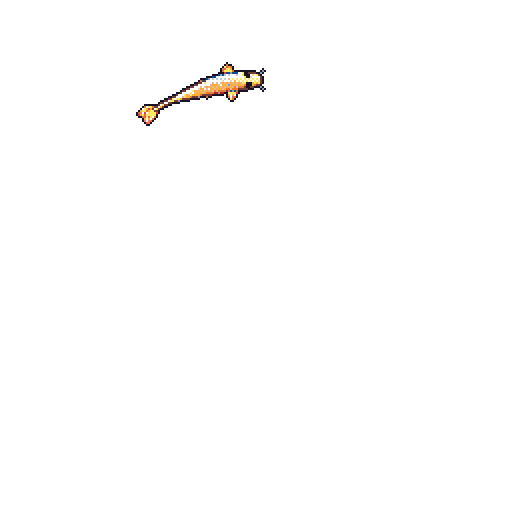

<!-- git-koi-start -->
<!-- git-koi-end -->

<!--
**tanayshah08118-ship-it/tanayshah08118-ship-it** is a ✨ _special_ ✨ repository because its `README.md` (this file) appears on your GitHub profile.

Here are some ideas to get you started:

- 🔭 I’m currently working on ...
- 🌱 I’m currently learning ...
- 👯 I’m looking to collaborate on ...
- 🤔 I’m looking for help with ...
- 💬 Ask me about ...
- 📫 How to reach me: ...
- 😄 Pronouns: ...
- ⚡ Fun fact: ...
-->
## Selected work

  

<b>Freelance developer or consultant</b>

## The idea behind the work

> Building useful things and learning in public.

- 👥 **0** followers · **0** following

*Small, useful work over vague claims.*

## Case studies

<table>
<tr><td width="32%"><b><a href="https://github.com/tanayshah08118-ship-it/ProjectUltron">ProjectUltron</a></b></td><td>A selected project from this GitHub profile. Python · 1 stars</td></tr>
<tr><td width="32%"><b><a href="https://github.com/tanayshah08118-ship-it/tanayshah08118-ship-it">tanayshah08118-ship-it</a></b></td><td>A selected project from this GitHub profile. HTML · 0 stars</td></tr>
<tr><td width="32%"><b><a href="https://github.com/tanayshah08118-ship-it/DevConnect">DevConnect</a></b></td><td>A selected project from this GitHub profile. HTML · 0 stars</td></tr>
<tr><td width="32%"><b><a href="https://github.com/tanayshah08118-ship-it/WDA-Project">WDA-Project</a></b></td><td>Web Development and Application project By IIIT Lucknow '30 students for Sem-1 open source · 0 stars</td></tr>
</table>

## Creative toolkit

  

## Make something memorable

  

<a href="https://github.com/tanayshah08118-ship-it">GitHub</a>

Tanay Shah  ·

